# Modelo de datos del Grupo 1

Las 19 tablas que son del Grupo 1 según la hoja **Diccionario de datos** del Excel. Las columnas se sacaron de la base real después de `php artisan migrate:fresh` (PostgreSQL).

GitHub dibuja el diagrama solo (Mermaid). Para verlo en VS Code, instalen la extensión "Markdown Preview Mermaid Support".

## Diagrama

Las líneas continuas son llaves foráneas que existen en la base. Las punteadas son relaciones que el código usa, pero que la base no obliga (ver [Diferencias con el Excel](#diferencias-con-el-excel)).

```mermaid
erDiagram
    users ||--o| estudiantes : "cuenta de"
    users ||--o| trabajadores : "cuenta de"
    users ||--o{ importaciones : "sube"

    facultades ||--o{ carreras : tiene
    carreras ||--o{ carrera_modalidad : "se ofrece en"
    modalidades ||--o{ carrera_modalidad : ""
    carreras ||--o{ mallas : tiene
    mallas ||--o{ malla_materia : incluye
    materias ||--o{ malla_materia : ""
    categorias_materia |o..o{ materias : clasifica

    materias ||--o{ cursos : "se dicta en"
    periodos ||--o{ cursos : ""
    trabajadores |o--o{ cursos : "es docente de"

    trabajadores ||--o{ rol_trabajador : tiene
    roles |o..o{ rol_trabajador : ""
    trabajadores ||--o{ facultad_trabajador : "trabaja en"
    facultades ||--o{ facultad_trabajador : ""
    trabajadores ||--o{ directores_carrera : dirige
    carreras ||--o{ directores_carrera : ""

    estudiantes ||--o{ carrera_estudiante : "se inscribe"
    carrera_modalidad ||--o{ carrera_estudiante : ""
    mallas |o--o{ carrera_estudiante : sigue

    users {
        bigint id PK
        string email UK
        string tipo "estudiante o trabajador"
        bool activo
    }
    facultades {
        bigint id PK
        string codigo UK
        string nombre
        string correo_notificaciones "nullable"
        bool activo
    }
    carreras {
        bigint id PK
        bigint facultad_id FK
        string codigo UK
        string nombre
        string nivel "grado o posgrado"
        bool admite_tercer_registro
        bool activo
    }
    modalidades {
        bigint id PK
        string nombre UK
    }
    carrera_modalidad {
        bigint id PK
        bigint carrera_id FK
        bigint modalidad_id FK
    }
    mallas {
        bigint id PK
        bigint carrera_id FK
        string version
        bool vigente "una por carrera"
    }
    categorias_materia {
        bigint id PK
        string nombre UK
    }
    materias {
        bigint id PK
        string codigo UK
        string nombre
        int creditos
        bigint categoria_materia_id "nullable"
        bool activo
    }
    malla_materia {
        bigint id PK
        bigint malla_id FK
        bigint materia_id FK
        smallint nivel
    }
    periodos {
        bigint id PK
        string codigo UK
        string nombre
        string tipo
        date fecha_inicio
        date fecha_fin
        smallint semana_primer_parcial
        bool activo "uno a la vez"
    }
    trabajadores {
        bigint id PK
        bigint user_id FK "nullable"
        string codigo UK
        string nombres
        string apellidos
        string correo UK
        bool activo
    }
    roles {
        bigint id PK
        string codigo UK "admin, asistente, director, docente, consulta"
        string nombre
    }
    rol_trabajador {
        bigint id PK
        bigint trabajador_id FK
        bigint rol_id
        string rol "copia del codigo"
    }
    facultad_trabajador {
        bigint id PK
        bigint trabajador_id FK
        bigint facultad_id FK
    }
    directores_carrera {
        bigint id PK
        bigint carrera_id FK
        bigint trabajador_id FK
        date fecha_inicio
        date fecha_fin "null = vigente"
    }
    cursos {
        bigint id PK
        bigint materia_id FK
        bigint periodo_id FK
        bigint profesor_id FK "nullable"
        string paralelo
        smallint cupo "nullable"
    }
    estudiantes {
        bigint id PK
        bigint user_id FK
        char codigo UK "10 caracteres"
        string cedula UK "nullable"
        string nombres
        string apellidos
        string correo UK
        string celular "nullable"
    }
    carrera_estudiante {
        bigint id PK
        bigint estudiante_id FK
        bigint carrera_modalidad_id FK
        bigint malla_id FK "nullable"
        date fecha_inscripcion
        date fecha_fin
        string estado "activo, inactivo, egresado, retirado"
    }
    importaciones {
        bigint id PK
        bigint user_id FK
        string entidad
        string archivo_ruta
        string estado "pendiente, procesando, completada, fallida"
        int total_filas
        int creadas
        int actualizadas
        int rechazadas
        json errores
    }
```

## Para qué sirve cada tabla

| Tabla | Para qué | Pantalla o forma de carga |
|---|---|---|
| `users` | Cuentas de acceso (estudiantes y personal) | Cuentas de acceso, Personal, importación de estudiantes |
| `facultades` | Las 9 facultades de grado | Facultades |
| `carreras` | Carreras de cada facultad | Carreras, importación |
| `modalidades` | Catálogo fijo de 6 modalidades | Seeder |
| `carrera_modalidad` | En qué modalidades se ofrece cada carrera. Tiene `id` propio para que la inscripción apunte a una sola fila | Carreras, importación |
| `mallas` | Versiones del plan de estudios | Mallas, importación |
| `categorias_materia` | Básica, Profesional, General… | Seeder |
| `materias` | Catálogo de asignaturas | Materias, importación |
| `malla_materia` | Materias de cada malla, con su nivel | Mallas, importación |
| `periodos` | Periodos académicos; uno activo | Periodos |
| `trabajadores` | Personal. El docente es un trabajador con rol `docente` y puede no tener cuenta | Personal, importación de docentes |
| `roles` | Los 5 roles fijos | Seeder |
| `rol_trabajador` | Roles de cada trabajador (puede tener varios) | Personal |
| `facultad_trabajador` | Facultades donde actúa cada trabajador (alcance de la asistente) | Personal |
| `directores_carrera` | Quién dirige cada carrera y en qué fechas | Directores de carrera |
| `cursos` | Paralelos de una materia en un periodo, con su docente | Paralelos, importación |
| `estudiantes` | Datos personales del estudiante | Importación |
| `carrera_estudiante` | Inscripción del estudiante en una carrera, modalidad y malla | Importación |
| `importaciones` | Historial de cada carga del SIAC | Importaciones SIAC |

## Tablas de otros grupos que apuntan a las del Grupo 1

| Tabla (grupo) | Columna | Apunta a |
|---|---|---|
| `solicitudes` (G2) | `carrera_estudiante_id` | `carrera_estudiante` |
| `solicitudes` (G2) | `periodo_id` | `periodos` |
| `solicitud_materia` (G2) | `curso_id` | `cursos` |
| `solicitud_materia` (G2) | `verificado_por` | `trabajadores` |
| `documentos_firmados` (G2) | `subido_por` | `users` |
| `cortes_agenda` (G3) | `facultad_id` | `facultades` |
| `revisiones` (G3) | `trabajador_id` | `trabajadores` |
| `historial_solicitud` (G3) | `user_id` | `users` |
| `resoluciones` (G3) | `registrada_por` | `users` |
| `conversaciones` (G4) | `user_id` | `users` |

Por eso hay reglas como "desactivar en lugar de borrar": si se borra una materia o un paralelo, las solicitudes antiguas perderían el dato.

## Diferencias con el Excel

| Tabla | Diferencia | Por qué |
|---|---|---|
| `materias` | `categoria_materia_id` no tiene llave foránea en la base | La migración original la agregó sin `constrained()`. El código sí valida que la categoría exista |
| `rol_trabajador` | Tiene `id` propio y una columna extra `rol` (texto) además de `rol_id`. `rol_id` no tiene llave foránea | Compatibilidad con el código que ya consultaba por texto. Se llenan las dos columnas |
| `trabajadores` | `codigo` es obligatorio; en el Excel es opcional | Así quedó la migración; las pantallas lo piden |
| `facultad_trabajador`, `malla_materia`, `carrera_modalidad` | Tienen `id` propio; en el Excel la llave es compuesta | Igual tienen una restricción única sobre el par, que cumple lo mismo |
