# Resumen de Cambios y Funcionamiento del Módulo Chatbot

**Fecha:** 20 de octubre de 2026  
**Módulo:** Chatbot Institucional / Interfaz Laravel + Motor Prolog  
**Requerimientos atendidos:**
> 1. *Interfaz con Laravel\* | Ajustar los textos para que no presenten información pendiente como definitiva. Alinear campos, identificadores, facultad y acciones; transformar correctamente la respuesta del motor.*
> 2. *Alineación de identificadores de trámites para evitar 404 en el botón «Iniciar esta solicitud»: Ayudante de cátedra, Examen de suficiencia y Examen supletorio.*
> 3. *Garantizar que `con_datos_verificados` sea `false` también cuando el origen sea `sesion` (los datos no provienen de SIAC).*

---

## 1. Visión General del Sistema

El módulo de Chatbot conecta una interfaz web interactiva en **Laravel** con un motor de reglas de conocimiento desarrollado en **SWI-Prolog** a través de una API HTTP interna (contrato JSON v2).

```mermaid
flowchart LR
    A["Estudiante (Chatbot Web)"] -->|"Petición HTTP JSON v2"| B["Laravel (ChatbotController / Request)"]
    B -->|"Normalización y Validación"| C["ChatbotOrchestratorService"]
    C -->|"PrologClient (POST /consulta o /evaluar)"| D["Motor SWI-Prolog (servidor.pl)"]
    D -->|"Reglas y Hechos"| E["Base de Conocimiento (hechos.pl / reglas.pl)"]
    E -->|"JSON v2 con resultado y avisos"| D
    D -->|"Respuesta HTTP"| C
    C -->|"Transformación Pública y Acciones"| B
    B -->|"JSON enriquecido"| A
```

---

## 2. Detalle de Cambios Realizados

### A. Precisión en los Textos (Información Pendiente vs. Definitiva)
> [!IMPORTANT]
> Se eliminó cualquier redacción categórica que hiciera pensar al estudiante que una evaluación orientativa o una consulta con datos por confirmar constituía una resolución final aprobada.

1. **Evaluación de elegibilidad (`evaluar_elegibilidad`):**
   * **Resultados preliminares (`cumple` con datos declarados):** El bot ya no afirma de forma absoluta *"Cumples los requisitos"*, sino que especifica:
     * *«Con los datos declarados ingresados cumples preliminarmente las condiciones reglamentarias evaluadas. Este resultado es de carácter orientativo y no definitivo; la Facultad validará los registros oficiales al procesar tu solicitud.»*
   * **Revisiones parciales (`requiere_revision` con `condiciones_no_evaluadas`):**
     * *«Solo se evaluó una parte de los requisitos con los datos declarados. Las condiciones restantes y la resolución definitiva deben ser confirmadas por la Facultad.»*
   * **Trámites sin motor de evaluación (`evaluacion_no_disponible`):**
     * *«Este trámite no cuenta con evaluación automática. Esta respuesta no determina cumplimiento definitivo ni rechazo; tu caso será revisado directamente por la Facultad.»*

2. **Aranceles y Plazos:**
   * **Costo por confirmar:** Cuando un trámite no cuenta con un arancel fijo validado en reglamento, el bot advierte:
     * *«El arancel o costo de este trámite se encuentra por confirmar con la Facultad y Secretaría.»*
   * **Plazo por confirmar:** Se aclara que las fechas límite dependen del calendario académico aprobado por la Facultad y el Consejo Académico.

---

### B. Alineación de Campos y Formularios

1. **Reglas de validación en [ChatbotMensajeRequest.php](../app/Modules/Chatbot/Http/Requests/ChatbotMensajeRequest.php):**
   * Se incorporaron y homologaron en `rules()` y `messages()` los nombres de campo y alias utilizados en [hechos.pl](../prolog/kb/hechos.pl):
     * Calificaciones y notas: `gpa_general`, `subject_grade`, `current_grade`.
     * Asistencia y oyente: `attendance`, `attended_as_listener`.
     * Historial y fechas: `last_recovery_date`.
     * Justificaciones: `reason`, `motivo`.

2. **Normalización hacia Prolog en [ChatbotOrchestratorService.php](../app/Services/Chatbot/ChatbotOrchestratorService.php):**
   * El método `normalizarPerfilParaProlog()` mapea de forma transparente todos los alias hacia los 4 campos canónicos aceptados por `servidor.pl`:
     * `promedio` (float, entre 0 y 100)
     * `asistencia` (float, entre 0 y 100)
     * `materia_id` (string)
     * `tipo_solicitante` (string)

---

### C. Alineación de Identificadores, Equivalencias y Acciones hacia el Portal

1. **Tabla de Equivalencias para Botones de Solicitud (Resolución de errores 404):**
   * El formulario de inicio de solicitudes del estudiante (`/estudiante/solicitudes/nueva?tramite=X`) utiliza identificadores simplificados definidos por el Grupo 2. Se implementó una tabla de equivalencias en `ChatbotOrchestratorService.php`:

| Trámite | Código en hechos.pl | Código esperado por formulario | URL de Inicio generada |
| :--- | :--- | :--- | :--- |
| **Ayudante de cátedra** | `ayudante-catedra` | `ayudante` | `/estudiante/solicitudes/nueva?tramite=ayudante` |
| **Examen de suficiencia** | `examen-suficiencia` | `suficiencia` | `/estudiante/solicitudes/nueva?tramite=suficiencia` |
| **Examen supletorio** | `examen-supletorio` | `supletorio` | `/estudiante/solicitudes/supletorio/nueva` (formulario propio) |
| **Examen de recuperación**| `examen-recuperacion` | `recuperacion` | `/estudiante/solicitudes/recuperacion/nueva` (formulario propio) |
| **Examen de gracia** | `examen-gracia` | `gracia` | `/estudiante/solicitudes/gracia/nueva` (formulario propio) |

2. **Normalización Defensiva en [TramitesSimulados.php](../app/Services/Solicitudes/TramitesSimulados.php):**
   * En `TramitesSimulados::buscar()`, se agregó resolución de alias para que si un usuario ingresa directamente `/estudiante/solicitudes/nueva?tramite=ayudante-catedra` o `examen-suficiencia`, el sistema resuelva correctamente la configuración del trámite y no devuelva 404.

3. **Alineación de Rutas en [routes/estudiantes.php](../routes/estudiantes.php):**
   * Se agregó redirección de `/estudiante/tramites/recalificacion` hacia `/estudiante/tramites/recalificacion-examen` para prevenir errores 404 entre el slug de la base de hechos y la vista Blade de ficha informativa.
   * Se aseguró la ruta `/estudiante/solicitudes/supletorio/nueva` para el formulario específico de examen supletorio.

4. **Contexto de Facultad Dinámico:**
   * En [chat-widget.blade.php](../resources/views/components/chat-widget.blade.php) y [chatbot.js](../public/assets/chatbot/chatbot.js), se configuró la propiedad `facultad` (`data-facultad`) para que el encabezado del chat no quede rígidamente estático, sino que adopte dinámicamente la facultad correspondiente o la predeterminada del estudiante.

---

### D. Verificación de Datos e Integridad del Atributo `con_datos_verificados`

1. **Garantía de `con_datos_verificados: false` para Sesión y Datos Declarados:**
   * En [ChatbotOrchestratorService.php](../app/Services/Chatbot/ChatbotOrchestratorService.php), `$resultado['con_datos_verificados']` se establece explícitamente en `false` tanto para origen `manual` como `sesion`.
   * **Justificación técnica:** Hoy los datos de sesión del usuario en Laravel no provienen de una integración oficial sincronizada con el SIAC institucional. Por consiguiente, los requisitos evaluados no pueden marcarse como institucionalmente verificados, garantizando que el widget `<x-resultado-elegibilidad>` muestre siempre la advertencia de carácter orientativo.
   * Se actualizó [respuesta.blade.php](../resources/views/components/chat/respuesta.blade.php) para respetar la bandera `con_datos_verificados` del resultado.

2. **Documentos con obligación explícita:**
   * En la respuesta pública de Laravel, cada documento adjunto garantiza la presencia de la propiedad `obligacion` (`'obligatorio'` o `'por_confirmar'`), consumida tanto por [documento.blade.php](../resources/views/components/chat/documento.blade.php) como por el motor de renderizado de `chatbot.js`.

---

## 3. Matriz de Archivos Modificados

| Archivo | Tipo de Cambio | Propósito |
| :--- | :--- | :--- |
| [ChatbotOrchestratorService.php](../app/Services/Chatbot/ChatbotOrchestratorService.php) | Backend / Orquestación | Tabla de equivalencias de URLs para trámites, garantía de `con_datos_verificados = false` para sesión y normalización de alias hacia Prolog. |
| [TramitesSimulados.php](../app/Services/Solicitudes/TramitesSimulados.php) | Backend / Portal | Normalización de alias en `buscar()` para prevenir 404 en el formulario de solicitudes del estudiante. |
| [ChatbotCatalogoService.php](../app/Services/Chatbot/ChatbotCatalogoService.php) | Backend / Catálogo | Extracción de `costo_texto` y `plazo_texto` desde [hechos.pl](../prolog/kb/hechos.pl). |
| [ChatbotMensajeRequest.php](../app/Modules/Chatbot/Http/Requests/ChatbotMensajeRequest.php) | Backend / Validación | Reglas y mensajes de validación para alias de calificaciones, asistencias y motivos. |
| [respuesta.blade.php](../resources/views/components/chat/respuesta.blade.php) | Frontend / Blade | Integración de `con_datos_verificados` en el componente de respuesta. |
| [chat-widget.blade.php](../resources/views/components/chat-widget.blade.php) | Frontend / Blade | Soporte para propiedad y atributo dinámico `facultad`. |
| [chatbot.js](../public/assets/chatbot/chatbot.js) | Frontend / JavaScript | Lectura del atributo `data-facultad` para la cabecera del chat cuando no hay trámite seleccionado. |
| [routes/estudiantes.php](../routes/estudiantes.php) | Enrutamiento | Redirección de ficha `/estudiante/tramites/recalificacion` y ruta para formulario de supletorio. |
| [ChatbotMensajeValidationTest.php](../tests/Feature/Chatbot/ChatbotMensajeValidationTest.php) | Pruebas Automatizadas | Tests de regresión para equivalencias de trámites (ayudante, suficiencia, supletorio) y validación de `con_datos_verificados = false` en sesión. |

---

## 4. Estado de Validación Automatizada

Se ejecutaron todas las suites de pruebas tanto de Laravel como de SWI-Prolog con éxito rotundo:

### Pruebas Feature Laravel (`php artisan test tests/Feature/Chatbot`):
* **[ChatbotControllerTest.php](../tests/Feature/Chatbot/ChatbotControllerTest.php):** 6/6 pasadas (10 assertions).
* **[ChatbotMensajeValidationTest.php](../tests/Feature/Chatbot/ChatbotMensajeValidationTest.php):** 24/24 pasadas (93 assertions).
* **[ChatbotPruebasTest.php](../tests/Feature/Chatbot/ChatbotPruebasTest.php):** 5/5 pasadas (17 assertions).
* **[HttpPrologClientTest.php](../tests/Feature/Chatbot/HttpPrologClientTest.php):** 13/13 pasadas (15 assertions).
* **[InterfazChatTest.php](../tests/Feature/Chatbot/InterfazChatTest.php):** 17/17 pasadas (80 assertions).
* **[PrologServiceTest.php](../tests/Feature/Chatbot/PrologServiceTest.php):** 6/6 pasadas (15 assertions).
* **Total:** **71 pruebas pasadas (262 assertions)**.

### Pruebas SWI-Prolog:
* `prolog/pruebas/reglas_chatbot.pl`: **15 pruebas (+136 sub-tests) pasadas (100%)**.
* `prolog/pruebas/integridad_conocimiento.pl`: **21 pruebas de integridad pasadas (100%)**.
